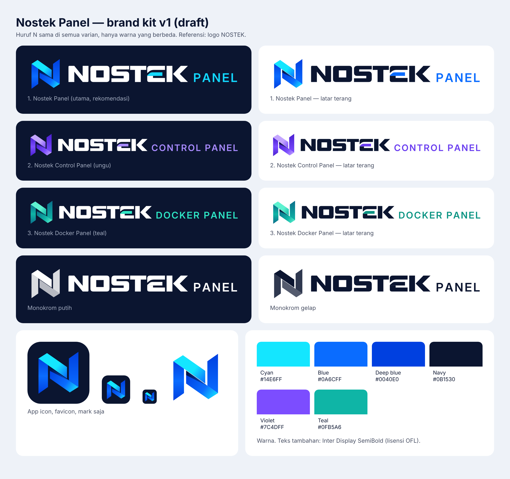

# Nostek Panel — brand kit v1 (draft)

Status: draft, waiting for owner approval (BRAND-1).

## Rules

- The **N mark is the same in every variant**: same shape, same proportions. Only colours change.
- The NOSTEK wordmark keeps its accent middle bar in the E.
- Suffix text (PANEL, CONTROL PANEL, DOCKER PANEL) is set in Inter Display SemiBold (SIL Open Font Licence),
  converted to outlines in the SVG files.
- Keep clear space around the logo of at least half the mark's width.
- Do not stretch, rotate, outline or recolour the mark outside the palettes below.

## Variants

| File | Use |
|---|---|
| `nostek-panel-on-dark.svg` / `nostek-panel-on-light.svg` | Main logo, transparent background (README, website) |
| `nostek-panel-dark.svg` / `nostek-panel-light.svg` | Main logo on its own background |
| `nostek-control-panel-*.svg` | Variant with violet accent |
| `nostek-docker-panel-*.svg` | Variant with teal accent |
| `nostek-panel-mono-*.svg` | One-colour versions |
| `nostek-mark.svg`, `nostek-app-icon.svg`, `nostek-favicon.svg`, `png/` | Icons |

## Palette

| Name | Hex |
|---|---|
| Cyan | `#14E6FF` |
| Blue | `#0A6CFF` |
| Deep blue | `#0040E0` |
| Navy (background / text) | `#0B1530` |
| Violet (Control Panel variant) | `#7C4DFF` |
| Teal (Docker Panel variant) | `#0FB5A6` |

Rebuild: `python3 assets/brand/src/build_brand.py assets/brand` (needs `fonttools` and Inter Display).
